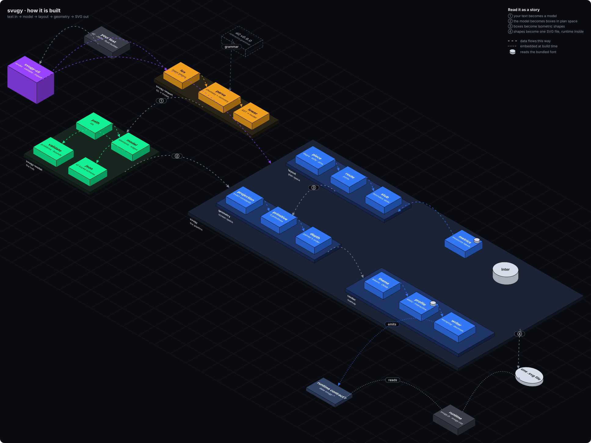

# svugy

Write a diagram in Markdown; svugy renders it as an isometric SVG you can click into.



```markdown
---
title: A web app
styles:
  store: (shape=cylinder, color=#d5dcea)
---

## Components
- browser: Browser (caption=the user's tab)
- backend: Backend (caption=your servers)
  - api: API (caption=HTTP endpoints)
- data: Data
  - db: Database (store)

## Edges
- browser -> api: places an order (traveler=envelope)
- api -> db: saves the order
```

- Frontmatter holds the title and shared styles; `## Components` is a nested list; `## Edges` lists `from -> to`.
- Any Markdown preview shows the file as an outline.
- The SVG is one file with its CSS and JavaScript inside: open it in a browser, nothing to install or serve.
- The same input renders the same bytes on every platform, wasm included, so committed SVGs diff cleanly.

## Quickstart

```sh
cargo install --git https://github.com/fedemagnani/svugy svugy-cli
svugy example -o webapp.md
svugy render webapp.md -o webapp.svg --open
```

- `svugy validate my.md` reports every problem in one run, with line and column; `--format json` for scripts and agents.
- `svugy render my.md --profile static -o my.svg` writes an SVG without script, for `` tags, READMEs and design tools.
- `svugy import my.d2 -o my.md` converts d2 to Markdown; `-o my.json` writes the model as JSON. `render` reads `.d2` and `.json` directly too.
- `svugy skill install` installs a Claude Code skill that writes, validates and renders diagrams.

[Markdown](docs/src/run/markdown.md) lists every rule.

## Crates

| Crate | Contents |
| --- | --- |
| [`svugy-model`](crates/svugy-model) | the model, its builder, its validation, and its layers: one per container depth, the deepest containers closed |
| [`svugy-parse`](crates/svugy-parse) | Markdown, d2 and JSON to the model; the model to Markdown and JSON |
| [`svugy`](crates/svugy) | model to SVG: text metrics, layout, geometry, render |
| [`svugy-cli`](crates/svugy-cli) | the `svugy` command |
| [`svugy-wasm`](crates/svugy-wasm) | svugy compiled to wasm, for the docs' live editors |
| [`svugy-dagre`](vendor/svugy-dagre) | dagre-dgl-rs, patched for deterministic layout |

## Docs

`just docs` renders the figures, compiles the wasm editor, builds the book from [`docs/src`](docs/src) and opens it.

## License

MIT or Apache-2.0, at your option. `svugy-dagre` keeps upstream's MIT license.
