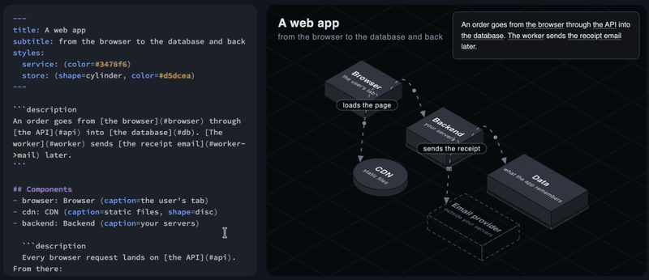

# svugy

[](https://crates.io/crates/svugy-cli)

- [Install svugy](#quickstart).
- Write your diagram in [Markdown](https://svugy.dev/docs/run/markdown.html) or in [another supported language](examples/webapp).
- Render it [as an SVG, or serve it for live rendering](#export-svg-and-rendering).



## Quickstart

```sh
curl -fsSL https://svugy.dev/install.sh | sh   # macOS, Linux
irm https://svugy.dev/install.ps1 | iex        # Windows
cargo install svugy-cli                        # any OS, with Rust
```

Add the skill to your agent with `npx skills add fedemagnani/svugy`, or to Claude Code with `svugy skill install`.

To let your agent do both, paste it the [installation prompt](https://svugy.dev/install.md).

## How it works

- Input text in any of the [supported languages](https://svugy.dev/docs/run/writing-diagrams.html) is parsed into a tree of elements: the `Model`.
- The `Model` is split into layers by depth. Each layer contains every component of the layer above it. The interactive feature is mostly a switch between these layers.
- Each layer is placed on an isometric 2D plane, where its components turn into [solids](crates/svugy/src/geometry).
- The scene is rendered in two flavors:
  - static: no CSS or JS, the deepest layer only.
  - interactive: every layer, with the embedded [runtime](crates/svugy/runtime/svugy.js) driving the interactive feature.

## Export SVG, PNG and rendering

```sh
svugy render my.md -o my.svg                    # export interactive SVG
svugy render my.md --profile static -o my.svg   # export static SVG
svugy render my.md --theme sketch -o my.svg     # hand-drawn look, with either profile
svugy render my.md --png -o my.png              # export PNG of the static SVG
svugy render my.md --png --depth 0 -o my.png    # export PNG of layer 0 only
svugy render my.md --png --all-depths -o my.png # export my-depth-0.png, my-depth-1.png, ...
svugy view my.md                                # live rendering in the browser, reloaded on every save
```

The interactive SVG inlines [`svugy.js`](crates/svugy/runtime/svugy.js) in a `<script>` tag, with no external URL. The interactive feature works only where the host lets the SVG's own script run:

- It runs when you open the `.svg` directly, embed it with `<object>` or `<iframe>`, or paste the `<svg>` inline into HTML.
- It doesn't run with ``, Markdown ``, or GitHub/GitLab READMEs: all of them load the SVG as an image.

Animations don't depend on the interactive feature: they use no script.

## License

MIT or Apache-2.0, at your option. `svugy-dagre` is MIT, as dagre-dgl-rs is. The sketch theme's strokes and hachure are ported from [rough.js](https://github.com/rough-stuff/rough) and [roughr](https://github.com/orhanbalci/rough-rs), both MIT.

The bundled fonts are under the SIL Open Font License 1.1: Inter ([OFL.txt](crates/svugy/assets/fonts/OFL.txt)) and Excalifont, © Excalidraw ([Excalifont-OFL.txt](crates/svugy/assets/fonts/Excalifont-OFL.txt)).
